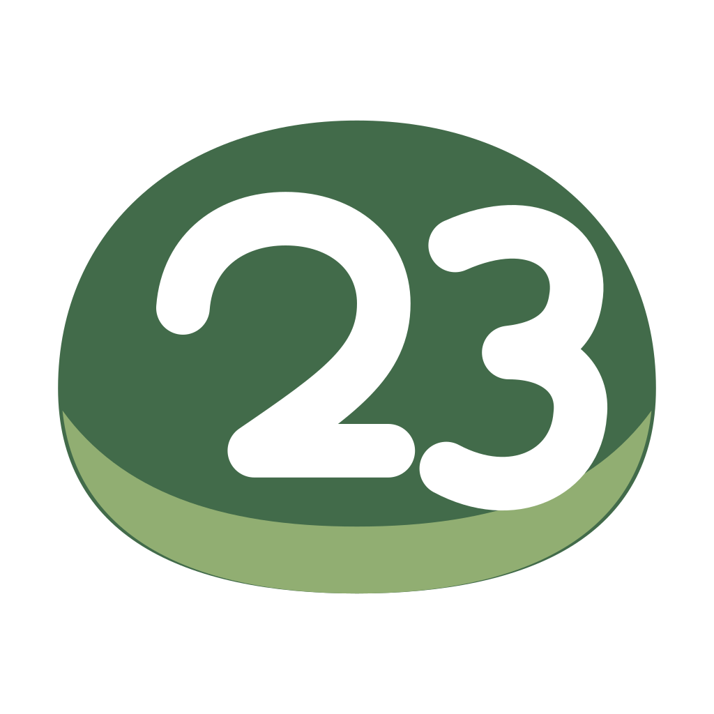

# 둘셋 브랜드 기준

확정일: 2026-11-18

## 이름

| 구분 | 표기 | 역할 |
|---|---|---|
| 서비스명 | 둘셋 | 화면·문서·브라우저 제목에 사용하는 이름 |
| 영문명 | Dos Tres | 영문으로 서비스명을 표기할 때 사용 |
| AI 비서·캐릭터 | 조이 (JOY) | 둘셋 안에서 대화와 신청 준비를 돕는 비서 |
| GitHub | dos-tres/frontend | 프론트엔드 저장소 |

서비스를 소개할 때는 ‘둘셋’, 비서에게 말하거나 비서를 설명할 때는 ‘조이’를 사용한다. 조이는 서비스명으로 사용하지 않는다.

## 확정 로고

사용자가 제공한 초록색 23 섬 로고가 공식 로고다. 숫자와 섬의 형태·비율·색상·여백을 유지하고 원본 파일을 그대로 사용한다. 임시 섬 그림이나 조이 캐릭터를 서비스 로고로 대체하지 않는다.

로고 3종은 `public/brand/`에 SVG와 1024×1024 PNG로 보관한다. 웹 화면은 SVG를 우선 사용하고 PNG는 이미지 첨부나 SVG를 지원하지 않는 곳에 사용한다. 이 파일들은 이미지 자동 복원 스크립트와 무관하게 직접 커밋한다.

| 종류 | 파일명 (SVG·PNG 공통) | 용도 |
|---|---|---|
| 섬 심볼 | dulset-island-symbol | 상단 로고·서비스 소개·브라우저 탭 파비콘 |
| 둥근 사각형 | dulset-island-square | Apple 홈 화면 바로가기용 아이콘 |
| 원형 | dulset-island-round | 프로필·공유용 아이콘 |

상단에는 섬 심볼과 HTML 텍스트 ‘둘셋’을 함께 표시한다. 브라우저 탭에도 동일한 투명 배경 섬 심볼(SVG 우선, PNG 대체)을 사용한다. 기존의 둥근 사각형 파비콘은 사용하지 않는다. Apple 홈 화면 바로가기는 OS의 아이콘 마스킹 특성을 고려해 기존 둥근 사각형 원본을 유지한다. 텍스트는 로고 파일을 변형한 워드마크가 아니다. 링크·버튼의 접근 가능한 이름은 ‘둘셋 홈으로’처럼 서비스명과 동작을 함께 설명한다. 옆의 텍스트나 버튼 이름이 의미를 전달하면 이미지에는 빈 대체 텍스트를 사용한다.

## 로고 색상

| 색상 | HEX | CSS 변수 |
|---|---|---|
| 초록 | #426B4A | --brand-green |
| 연두 | #91AE72 | --brand-light-green |
| 흰색 | #FFFFFF | --brand-white |

이 색상은 공식 로고와 서비스명 표기의 브랜드 색상이다. 기존 화면의 행동·상태 색상과 조이 캐릭터 팔레트는 [JOY 디자인 기준](JOY_design_guidelines.md)을 따른다. 로고 확정은 UI 전체를 초록색으로 전환하거나 조이 원본을 재색칠한다는 의미가 아니다.

## 구현 위치

- 상단 심볼·서비스명: `src/App.tsx`, `src/styles.css`
- 파비콘·바로가기 아이콘·브라우저 제목·메타 정보: `index.html`
- 원본 SVG·PNG 6개: `public/brand/`
- 에셋 목록과 상태: [asset-manifest.json](asset-manifest.json)

후속 화면 작업에서도 이 이름과 로고를 재사용한다. 로고를 다시 생성하거나 페이지별로 다른 브랜드 표기를 만들지 않는다.

## 홈 디자인 실험 (2026-11-21)

사용자가 로고 색부터 정보 위계·아이콘·세계관을 정리하는 홈 디자인을 요청했다. `design/home-paper-village`에서는 기존 로고 원본과 조이 외형을 유지하며 초록·연두를 홈의 안내와 큰 인상으로 확장하고 파랑은 AI 대화 입력에 집중한다. 공통 화면 전체의 색상 전환이 아니며 홈 범위 CSS로만 적용한다. 디자인 검토 전 시안이며 최종 승인·main 반영은 별도다. [시안 범위와 에셋 출처](home-paper-village.md).
