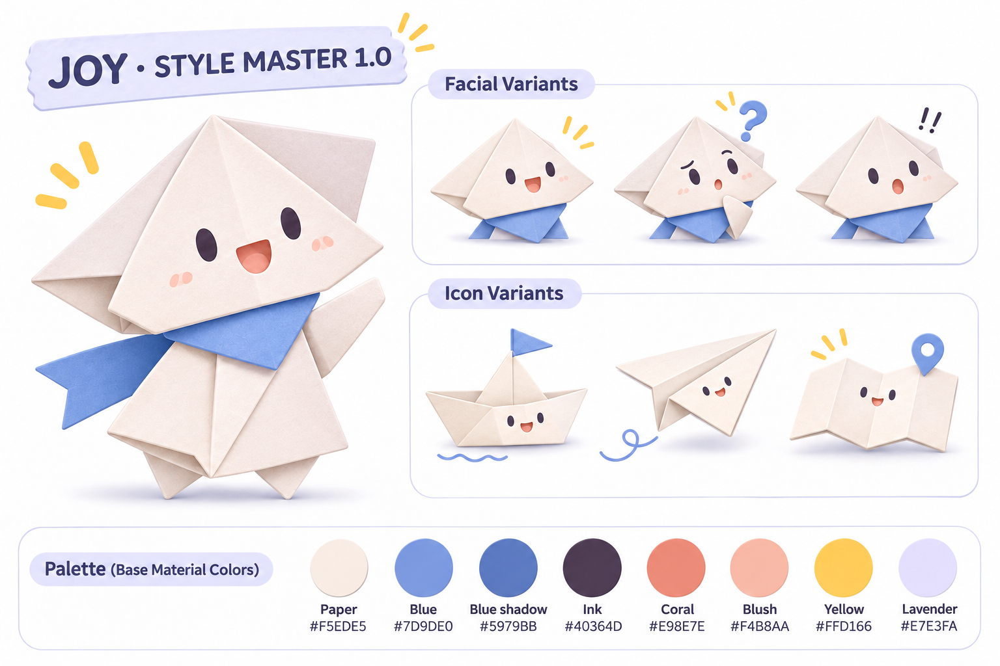

# 대표 이미지·아이콘 참고

| 자료 | 용도 |
|---|---|
| joy-style-master.png | 조이의 형태·종이 질감·표정과 종이배·비행기·지도 변신 예시 |
| ../JOY_design_guidelines.md | 확정 UI 팔레트와 캐릭터 유지 규칙 |

시트 내부의 색상값과 문서가 다르면 **확정 문서**를 따른다. 원본 이미지는 재색칠하지 않는다.
이 시트는 화면에 그대로 넣는 UI 이미지가 아니라 디자인 참고 자료다. 개별 투명 아이콘은 별도 제작이 필요하다. 기존 실행용 이미지는 src/assets/characters와 자동 복원 PNG를 사용한다.
레이아웃과 문구는 미확정이며 보편적인 UX 원칙에 따라 설계할 수 있다.
