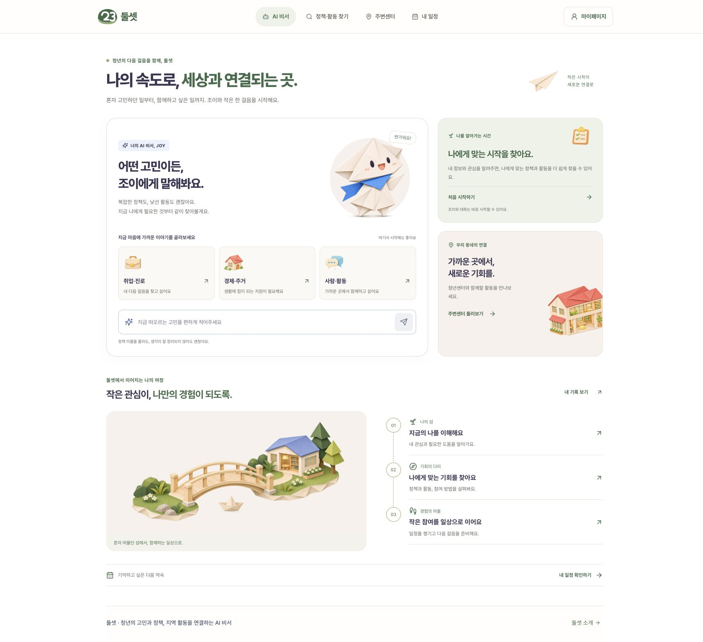
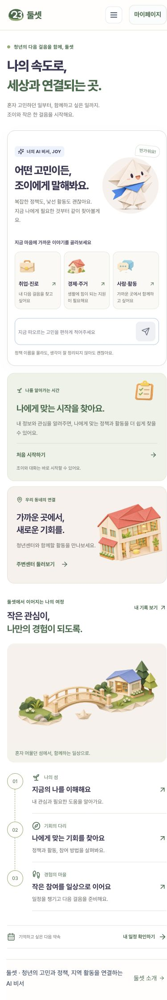

# 홈 디자인 검증 · 2026-11-21

브랜치: design/home-paper-village. main 병합·배포 전 디자인 검토용.

- npm ci --offline: 122개 의존성 설치, 기존 PNG 복원 성공.
- npm run build: TypeScript와 Vite 빌드 성공. 기존 500kB 청크 경고는 유지한다.
- 실제 Chrome에서 1728px 데스크톱, 390px 모바일 전체 페이지 확인. 조이/아이콘/생성 다리 이미지 로딩 성공, 텍스트·일러스트 겹침 점검.
- 320px에서 조이 이미지의 가로 넘침을 발견해 max-width와 grid min-width를 수정. 수정 후 document scrollWidth=320, 화면 밖 홈 요소 0개 확인.
- 빠른 질문 ‘취업·진로’: 기존 조이 대화 화면으로 이동하고 원래 질문과 기존 공고 기반 안내를 표시하는 것을 확인.
- 직접 입력 ‘주거 지원이 궁금해요’: 입력/제출 후 기존 대화로 전달됨 확인. 빈 입력은 전송 버튼 비활성.
- 처음 시작하기: 기존 내 정보 입력 화면으로 이동 확인. 개인정보를 입력·저장하지 않았다.
- 모바일 메뉴 열기/닫기 확인, 임시 viewport override 복구.
- 이미지 대체 텍스트, 장식 이미지 빈 alt, 입력 label, 44px 전송/보조 행동, 홈 focus-visible 스타일은 코드 검토. 키보드 전 경로 및 자동 접근성 감사는 미실행.

## 캡처

## 남은 검토

사용자의 시각 디자인 확인 전이다. 완성된 생성형 AI/자동 신청을 추가한 것이 아니며 실제 API/센터·정책/일정 전 경로 회귀 검증은 이 디자인 변경 범위에 포함하지 않았다. 기존 콜백과 화면을 재사용한다. 완료 사용자의 조건부 생활 점검 문구는 코드로 검토했고 실제 저장 이력을 새로 생성하지 않았다.
