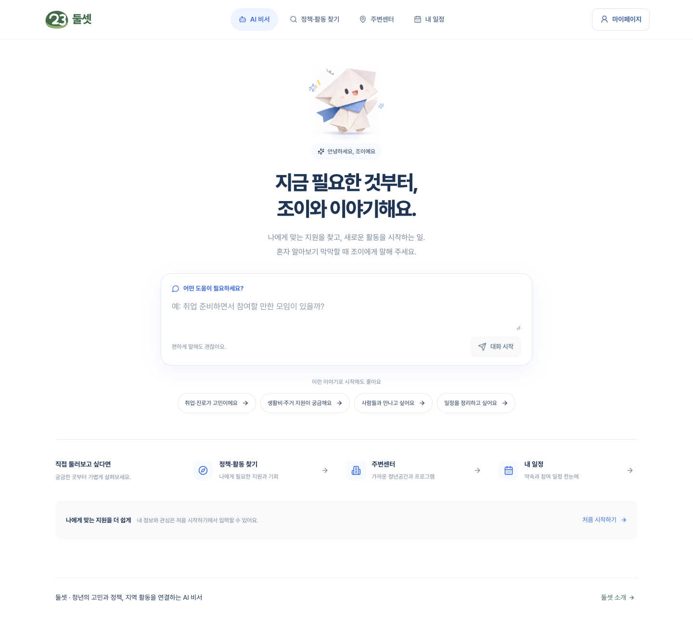
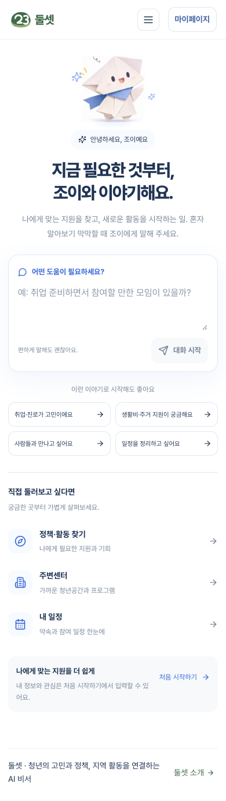

# 조이 대화 중심 메인 검증

- 실제 로컬 Chrome: 데스크톱 1440×1000, 모바일 390×844.
- 큰 메시지 입력창, 네 가지 시작 선택지, 정책·센터·일정 보조 바로가기.
- 원본 조이 확대, 인사·떠오름·호버·클릭·입력 집중 반응. prefers-reduced-motion에서 모션 중지.
- 빈 입력 차단, 한글 IME 조합 Enter 보호, Shift+Enter 줄바꿈, Enter와 버튼 전송, 선택지 사용자 메시지 전달 확인.
- 세 바로가기와 모바일 가로 넘침 없음, pageerror 0 확인.
- npm run build 및 기존 센터·일정 표시 검사 통과. 기존 500KB 청크 경고 유지.
- 캡처는 개인 정보 없는 별도 브라우저에서 모션 줄이기 설정으로 저장. 애니메이션 동작은 별도 실제 transform 변화 검사로 확인.
- paper-village 아이콘 적용은 사용자 요청으로 철회. 원본 조이와 기존 선 아이콘 유지.
- 실제 LLM/외부 신청/전화/백엔드 변경은 포함하지 않음.

## 데스크톱

## 모바일

